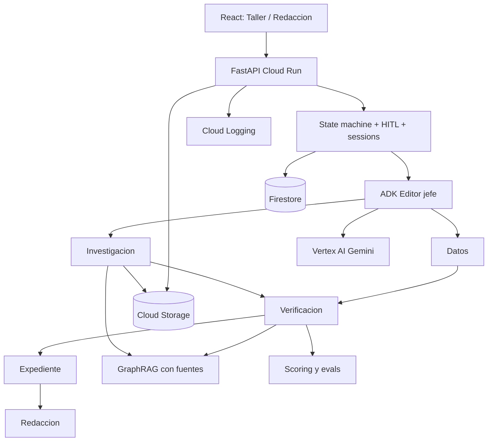

# Decisiones de arquitectura — v0.5

## ADR-004 — Dos perfiles sobre mismo motor
`TALLER`: artículos y fuentes autorizadas, 3 HITL + 1 transición no aplicable, índice descriptivo, exportación Word. `REDACCION`: investigación de fuentes externas con cuatro aprobaciones humanas. Los contratos `Case/Evidence/ClaimAssessment` se reutilizan y `profile` gobierna herramientas y estado.

## ADR-005 — Clasificación sustentada, no certeza aparente
El modelo estima postura del fragmento; backend comprueba fuentes recuperadas y pertinencia; contradicciones y ausencia se abstienen. La fuente oficial solo prueba por sí misma una declaración, no cualquier hecho externo. `p_false` está ausente sin calibración empírica.

## ADR-006 — Dos motores reutilizables
GraphRAG por caso para aristas con citas y preguntas multi-hop; evaluación de verificación para métricas por afirmación. Ambos son herramientas, no agentes autónomos. NetworkX/JSON y corpus limitado en Fast PoC. Benchmark RAG vs GraphRAG imprescindible antes de afirmar mejora.

## ADR-007 — Orquestación asíncrona y control de costos
API FastAPI en Cloud Run, ADK con agentes in-process, Firestore para estados y aprobaciones, Cloud Storage para evidencias. Cada verificación es trabajo idempotente y observable; no usar memoria de proceso como almacén durable. Evaluar Cloud Tasks/Jobs si duración, cuotas o concurrencia lo exigen. Validar sesión aislada y carga de 30 participantes.

## ADR-008 — Seguridad de ingesta y expiración
Fuentes HTML/PDF son entrada no confiable. Allowlists HTTPS, protección SSRF tras cada resolución/redirección, MIME/bytes/tiempo/páginas limitados, sanitización de logs. TTL no implica que todos los blobs desaparezcan automáticamente: configurar y probar políticas de retención/borrado de cada almacén.

## Diagrama lógico

