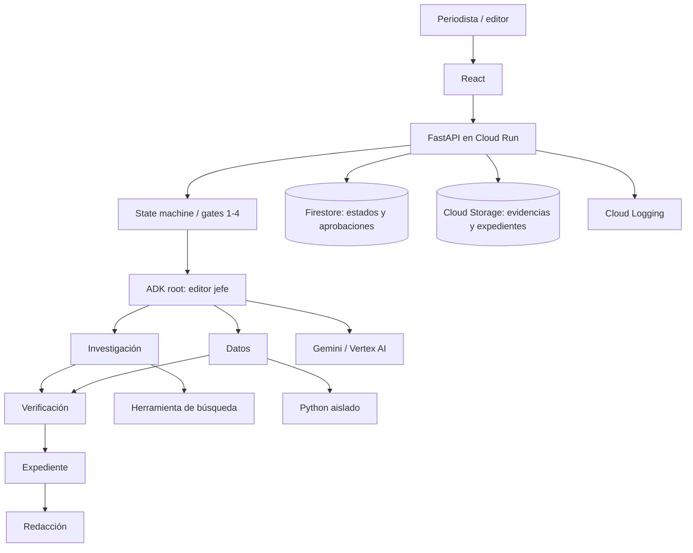
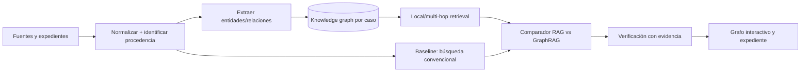

# Arquitectura GCP — FAST DEMO

## Selección de patrones DevPattern
- `definition-packs/minimum-sufficient-specification.md`: SPEC.md antes de codificar.
- `agentic-reference-architectures/gcp.md`: Cloud Run + ADK + Gemini, evitar infraestructura innecesaria.
- `patterns/implementation-profiles/gcp/pattern-pack-mapping.md`: multi-agent manager in-process, HITL con estado persistente.
- `patterns/pattern-packs/governed-agent.md`: capacidades y autorizaciones deterministas.
- `examples/legal-contract-agent-fast-demo/GCP-FAST-DEMO.md`: React + FastAPI + ADK + Cloud Run, ajustado para el dominio periodístico.

## Por qué sí multiagente en FAST DEMO
Ya existen seis skills independientes validados de forma exploratoria en Claude. Reutilizar el reparto de trabajo genera una demostración diferenciada; **no** implica seis servicios ni seis runtimes separados.

## Arquitectura

**Importante:** las flechas entre agentes representan precedencia lógica, pero las transiciones están gobernadas por FSM/API. ADK no debe completar todo el proceso en una invocación que ignore las aprobaciones.

## Etapas
`NEW -> PLAN_READY -> WAITING_G1 -> RESEARCH -> WAITING_G2 -> VERIFICATION -> DOSSIER_READY -> WAITING_G3 -> DRAFT_READY -> WAITING_G4 -> EDITOR_APPROVED`.

`REJECTED`, `INCONCLUSIVE` y `ERROR` son estados explícitos. Solo el backend con identidad autorizada cambia de gate.

## Herramientas y límites
- Consulta de fuentes: dominios autorizados, URLs y fecha de recuperación; preservar cadena de fuente original.
- Análisis tabular: Python aislado, solo archivos del caso y límites de CPU/memoria/tiempo.
- Agente de redacción: sin búsqueda, solo dossier aprobado.
- Autorización: cuentas de servicio IAM y reglas de aplicación; no confiar en el prompt.
- Persistencia: Firestore para flujo; Cloud Storage para originales, versiones y hashes.
- Seguridad: todo contenido web es no confiable, proteger contra prompt injection.

## Diferencia de Agent Engine
Se posterga Agent Engine administrado hasta medir necesidad real de sesiones, escalado o runtime. El primer despliegue corre ADK dentro de Cloud Run.

## Validación antes de promoción
Comprobar costo/tokens por investigación, latencia, citas, bloqueos de aprobación, resistencia a inyección y factibilidad de consulta de fuentes.

## GraphRAG FAST DEMO (decisión ADR-002)
GraphRAG entra **en alcance de demostración**, de acuerdo con `DevPattern/patterns/pattern-packs/graphrag.md`, por preguntas periodísticas de múltiples fuentes y relaciones entre empresas, contratos, individuos, hechos y declaraciones.

**FAST PoC pragmática:** grafo tipado en memoria (NetworkX o equivalente) serializado a JSON en Cloud Storage; Firestore mantiene metadatos/versiones. El adaptador `graph_repository` permite reemplazarlo por un almacén de grafos cuando sea justificado. No introducir servicio de base de grafos solo por marketing.

**Experiencia visible:** seleccionar nodo de empresa → ver contratos relacionados → filtrar por fechas y proveedores → abrir arista con fuente original → consultar camino de dos o tres saltos; diferenciar asociación documentada de inferencia. Mostrar comparativa contra RAG convencional para una pregunta relacional.

**Integridad:** cada arista mantiene `evidence_ids`, `retrieved_at`, `relation_type`, `status`; para relaciones ambiguas solicitar validación humana. La visualización es ayuda exploratoria, no prueba legal ni veredicto automático.

**Evaluación:** benchmark local/global predefinido y golden set de enlaces; trazabilidad de aristas, precisión relacional, tiempo/costo e índice de inferencias falsas. Seguir patrón DevPattern: solo promover especialización si mejora la recuperación tradicional.
